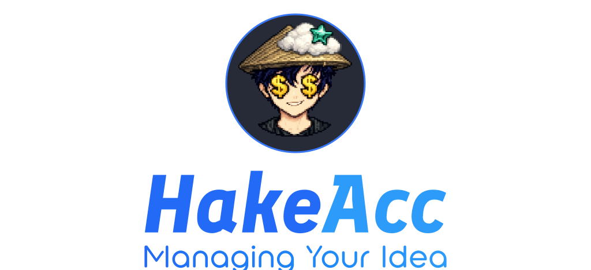
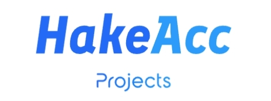
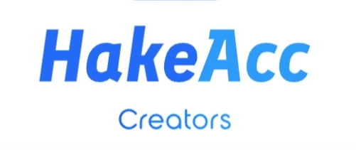
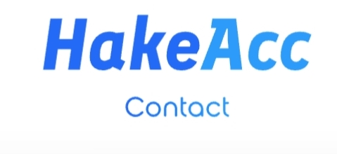

  <!-- Main Supplied Banner (Custom vector typography with authentic personal avatar) -->
  

    

  <h3>Full-Stack Developer &bull; Discord Systems Architect &bull; Creator Operations Lead</h3>

  

    <a href="https://hake-drab.vercel.app/">Website</a> &bull;
    <a href="#featured-projects">Projects</a> &bull;
    <a href="#creator-operations">Creator Ops</a> &bull;
    <a href="#technologies--skills">Skills</a> &bull;
    <a href="#contact">Contact</a>
  

---

### About Me

Hi, I'm **Hake** ([@hake-acc](https://github.com/hake-acc)). I build fast, resilient web applications, custom community automation systems, and high-performance digital platforms.

With a background spanning modern frontend architecture (Astro, TypeScript, React), real-time automation tooling, and creator community operations, I focus on building reliable systems that scale smoothly under high traffic.

- 🌐 **Live Website**: [hake-drab.vercel.app](https://hake-drab.vercel.app/) *(canonical: [hake-acc.vercel.app](https://hake-acc.vercel.app/))*
- 📍 **Focus Areas**: Static-first web apps, headless UI, Discord bot ecosystems, and automated creator pipelines.
- ⚡ **Philosophy**: Clean code, zero unnecessary dependencies, and authentic execution over vanity metrics.

---

### What I Build

- **Modern Web Applications** — Static-first architectures, selectively hydrated React islands, and accessible interfaces with zero render latency.
- **Community Infrastructure & Automation** — Custom Discord bot development, automated onboarding channels, permission matrices, and raid defense.
- **Creator Operations Pipelines** — Technical packaging, distribution systems, and workflow coordination for YouTube creators with millions of viewers.

---

  

### Featured Projects

#### 1. [Pixel Portfolio Platform](https://github.com/hake-acc/hake-acc)
*Cinematic, high-performance personal portfolio website and multi-page showcase.*
- **Stack**: Astro 5, React 18, TypeScript, Tailwind CSS v3, Framer Motion
- **Architecture**: Static Site Generation (SSG) with React Islands for interactive widgets (character state machines, interactive calculator, audio engine).
- **Features**: Dual-mode theme system (Daylight / Discord Dark `#1e1f22`), vector paper-plane physics animation, and 100/100 Core Web Vitals.
- **Links**: [Repository](https://github.com/hake-acc/hake-acc) &bull; [Live Demo](https://hake-drab.vercel.app/)

#### 2. [WebMirror](https://github.com/hake-acc/webmirror)
*High-fidelity website cloning Android app and browser-processing engine.*
- **Stack**: TypeScript, Android WebView, Browser Automation
- **Architecture**: Mobile client coupled with browser processing pipelines for capturing, sanitizing, and replicating responsive website assets for offline testing and archiving.
- **Links**: [Repository](https://github.com/hake-acc/webmirror)

#### 3. [ExtoArts Studio Platform](https://github.com/hake-acc/extoartssample3)
*Creative agency web application engineered for video editing operations.*
- **Stack**: Vite, React, TypeScript, Tailwind CSS, GSAP
- **Architecture**: Modular component architecture with smooth scroll-driven choreography and responsive layout tokens tailored for creative agencies.
- **Links**: [Repository](https://github.com/hake-acc/extoartssample3)

#### 4. [OwO Dusk](https://github.com/hake-acc/owo-dusk)
*Cross-platform notification engine and automation controller with real-time web dashboard.*
- **Stack**: Python, JavaScript, WebSockets, HTML5
- **Architecture**: Event-driven background controller supporting desktop and mobile notifications, paired with an interactive monitoring web dashboard.
- **Links**: [Repository](https://github.com/hake-acc/owo-dusk)

---

  

### Creator Operations & Community Impact

Beyond standalone codebases, I engineer operational backends and Discord ecosystems for established gaming creators and YouTube channels:

| Creator Channel | Reach | Role & Technical Deliverables |
|:---|:---|:---|
| **Cappy Mc** | **95.3K Subs** &bull; 252K Top Views | Lead Channel Management, Title Hook Formulas, 28K Discord Community Hub |
| **CappuXD** | **17.7K Subs** &bull; 1M+ Viral Hit | Shorts Scaling, VOD Packaging, Cross-Channel Funneling, 18K Discord Hub |
| **Alex Adi XD** | **34.6K Subs** &bull; 180K Top Views | Server Architecture, Upload Synchronization, 15K Discord Hub |
| **MC Thunder Playz** | **22.8K Subs** &bull; 140K Top Views | Community Infrastructure, Moderation Hierarchy, 12K Member Server |
| **Arpan Gamzo** | **16.4K Subs** &bull; 95K Top Views | Community Moderation Workflows, Bot Automation, 9K Discord Members |

- **25+** communities structured and secured
- **600M+** combined creator view reach
- **100,000+** Discord members across managed servers
- **Zero** raid breaches across hardened Discord environments

---

### Technologies & Skills

- **Languages & Frameworks**: TypeScript, JavaScript (ESNext), Python, Astro, React 18, HTML5, CSS3 / Tailwind CSS
- **Frontend Architecture**: Static Site Generation (SSG), React Islands, Framer Motion, GSAP, Responsive Design, Web Accessibility (WCAG AA)
- **Backend & Automation**: Node.js, Discord API / Bot Development, WebSockets, REST APIs, Automation Scripting
- **Infrastructure & Tools**: Git, GitHub, Vercel, Vite, Linux / Bash, PostCSS

---

  

### Contact

Looking to collaborate on a development project, scale a web platform, or restructure your Discord community?

- 🌐 **Portfolio & Contact Form**: [hake-drab.vercel.app](https://hake-drab.vercel.app/#contact)
- 🐦 **Twitter / X**: [@hake_acc](https://twitter.com/hake_acc)
- 💬 **Discord**: Reach out directly via the [contact form on my site](https://hake-drab.vercel.app/#contact)
- 🐙 **GitHub**: [@hake-acc](https://github.com/hake-acc)

 

  &copy; 2026 Hake Acc. Personal developer portfolio and profile presentation.

