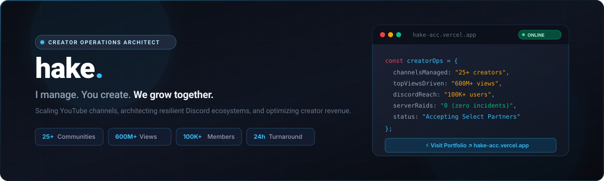
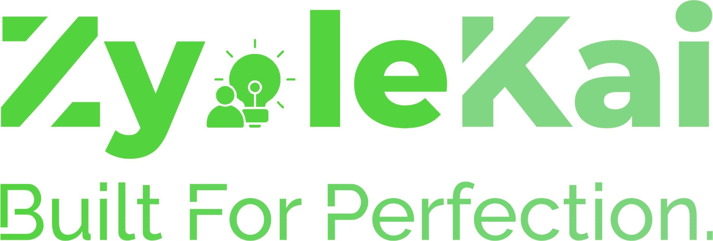
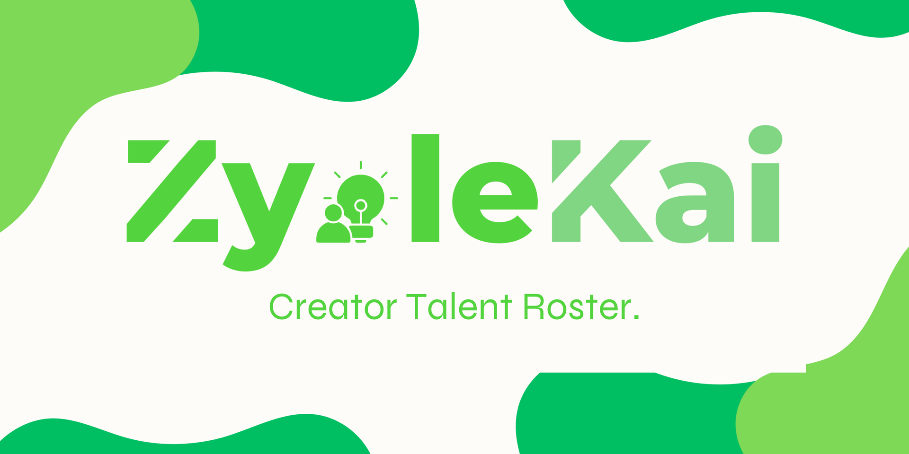
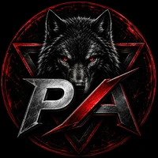

<div align="center">

  <!-- Header Banner -->
  <a href="https://hake-acc.vercel.app/" target="_blank" rel="noopener noreferrer">
    
  </a>

  <br/><br/>

  <!-- Personal Icon Avatar -->
  <a href="https://hake-acc.vercel.app/" target="_blank" rel="noopener noreferrer">
    
  </a>

  <h1>hake<span style="color:#38bdf8">.</span></h1>

  <p><strong>Social Media Manager &bull; Discord Server Architect &bull; Creator Agency Founder</strong></p>

  <p><em>"I manage. You create. We grow together."</em></p>

  <!-- Tasteful Badges Row -->
  <p>
    <a href="https://hake-acc.vercel.app/" target="_blank" rel="noopener noreferrer">
      
    </a>
    <a href="https://astro.build/" target="_blank" rel="noopener noreferrer">
      
    </a>
    <a href="https://react.dev/" target="_blank" rel="noopener noreferrer">
      
    </a>
    <a href="https://www.typescriptlang.org/" target="_blank" rel="noopener noreferrer">
      
    </a>
    <a href="https://tailwindcss.com/" target="_blank" rel="noopener noreferrer">
      
    </a>
  </p>

  <p>
    <a href="#-managed-creators--case-studies">Featured Creators</a> &bull;
    <a href="#-core-deliverables">Services</a> &bull;
    <a href="#-portfolio-architecture">Architecture</a> &bull;
    <a href="#-quick-start">Quick Start</a> &bull;
    <a href="https://hake-acc.vercel.app/" target="_blank" rel="noopener noreferrer">Live Website &rarr;</a>
  </p>

</div>

---

## ⚡ Executive Summary

Fast-growing YouTube creators and gaming channel operators (10K to 2M+ reach) face overwhelming operational burdens: Discord moderation, bot management, video editor pipelines, sponsor communications, and upload pacing. 

I provide the dedicated operational backbone so creators can stay 100% focused on creating content. Deeply immersed in Discord server structures and creator dynamics, I deliver hands-on execution rather than theoretical agency consulting—with zero corporate fluff, zero inflated benchmarks, and 100% verified creator results.

<div align="center">
  
</div>

### 📊 Verified Creator Track Record

| Metric | Achievement | Operational Context |
|:---|:---:|:---|
| **Communities Architected** | **25+** | Scaled & secured Discord creator hubs |
| **Combined View Reach** | **600M+** | Views generated across managed channel networks |
| **Total Discord Reach** | **100,000+** | Active members across gaming & creator servers |
| **Turnaround Time** | **&lt; 24h** | Direct Discord communications & incident response |
| **Security Record** | **0 Raids** | Zero raid incidents across hardened communities |

---

## 🎮 Managed Creators & Case Studies

<div align="center">
  
</div>

A selection of prominent gaming creators and YouTube communities managed, structured, and grown:

| Creator | Reach & Metrics | Focus & Deliverables | Channel Link |
|:---|:---|:---|:---:|
|  **Cappy Mc** | **95.3K Subs** &bull; 252K Top Views | Lead Channel Management, Title Hook Formulas, Thumbnail A/B Variants, 28K Discord Hub | [YouTube &rarr;](https://youtube.com/@cappy-mc?si=OejN4xeqeLOyf4xl) |
|  **CappuXD** | **17.7K Subs** &bull; 1M+ Viral Hit | Shorts Scaling, VOD Packaging, Cross-Channel Funneling, 18K Discord Hub | [YouTube &rarr;](https://www.youtube.com/@CappuXD) |
|  **Alex Adi XD** | **34.6K Subs** &bull; 180K Top Views | Server Architecture, Upload Synchronization, Community Events, 15K Discord Hub | [YouTube &rarr;](https://youtube.com/@alexadixd) |
|  **MC Thunder Playz** | **22.8K Subs** &bull; 140K Top Views | Minecraft Community Management, Moderation Hierarchy, 12K Discord Server | [YouTube &rarr;](https://youtube.com/@mcthunderplayz) |
|  **Arpan Gamzo** | **16.4K Subs** &bull; 95K Top Views | Community Moderation Workflows, Bot Automation, 9K Discord Members | [YouTube &rarr;](https://youtube.com/@arpangamzo) |
|  **Not Vangid** | **12.1K Subs** &bull; 80K Top Views | Content Upload Scheduling, Discord Onboarding, 8K Discord Server | [YouTube &rarr;](https://youtube.com/@notvangid) |
|  **Sky Plays** | **8.9K Subs** &bull; 65K Top Views | Discord Server Relaunch, Role Hierarchy Optimization, 6K Community | [YouTube &rarr;](https://youtube.com/@skyplays) |

---

## 🛠️ Core Deliverables

<div align="center">
  
</div>

Each engagement is tailored to solve specific creator bottlenecks:

1. **Social Media & Channel Operations**: Multi-platform release scheduling, community post engagement, and YouTube Studio metadata optimization.
2. **Sponsorships & Brand Deals**: Inbound sponsor vetting, rate card negotiations, contract reviews, and deliverable sign-offs.
3. **Discord Server Architecture**: Clean category layouts, automated onboarding channels, permission matrices, and bot automation (ticket systems, leveling, verification).
4. **Content Editing Pipeline Coordination**: Managing thumbnail designers, shorts editors, and video editors with tight turnaround deadlines.
5. **Content Strategy & Packaging**: High-contrast thumbnail ideation, title hook iteration, and audience retention pacing.
6. **Reporting & Growth Insights**: Weekly audience retention analytics, community churn tracking, and CTR uplift reviews.

---

## 💻 Portfolio Architecture

The portfolio at [hake-acc.vercel.app](https://hake-acc.vercel.app/) is built with modern performance engineering:

```
hake-acc/
├── src/
│   ├── components/         # Interactive React Islands & Astro components
│   │   ├── HakeLandingPage.astro  # Master orchestrated landing experience
│   │   ├── Hero.tsx               # Character animations, creator badges, video backdrop
│   │   ├── Projects.tsx           # Interactive channel showcase with YouTube stats
│   │   ├── Services.tsx           # 6 core deliverables interactive bento grid
│   │   ├── GrowthCalculator.tsx   # Interactive creator revenue & reach estimator
│   │   ├── TerminalSimulator.tsx  # Interactive Discord ops command simulator
│   │   ├── ChannelDefenderGame.tsx# Retro pixel defense mini-game
│   │   ├── ContactForm.tsx        # Direct creator outreach form
│   │   └── Sidebar.tsx            # Glassmorphic navigation dock with theme toggle
│   ├── layouts/
│   │   └── HakeLayout.astro       # Universal layout with ClientRouter & meta tags
│   ├── pages/                     # Multi-page Astro routing (index, about, services, etc.)
│   ├── styles/                    # Tailwind CSS v3 & custom design tokens
│   └── data/content.json          # Single source of truth for stats, channels, and copy
├── public/
│   ├── brand/                     # Official banners, logos, and wordmarks
│   ├── creators/                  # Locally hosted, transparent creator avatars
│   └── assets/                    # Optimized videos, icons, and illustration layers
└── assets/
    └── readme/                    # Self-contained assets for GitHub profile & README
```

### Highlights:
- **Astro 5 SSG**: Static-first delivery with near-zero runtime JavaScript by default.
- **Selective Hydration (React Islands)**: Heavy interactive features use `client:visible` or `client:load` for maximum Core Web Vitals score.
- **Dual Visual Theme**: Seamless toggling between Daylight Mode and Discord Dark Theme (`#1e1f22`, `#313338`) with zero Flash of Unstyled Content (FOUC).
- **Responsive Vector Graphics**: Pure vector SVG paper-plane flight mechanics and scalable brand assets.

---

## 🚀 Quick Start

### Prerequisites
- Node.js `20.x` or higher
- npm `10.x` or higher

### Local Development

```bash
# 1. Clone repository
git clone https://github.com/hake-acc/hake-acc.git
cd hake-acc

# 2. Install dependencies with legacy peer deps
npm install --legacy-peer-deps

# 3. Start local development server
npm run dev

# 4. Build production static bundle
npm run build

# 5. Preview production output
npm run preview
```

---

## 🔒 Security & Privacy Notice

- **Public Showcase Repository**: This repository hosts the public-facing portfolio website, documentation, and creator showcase.
- **Zero Exposed Secrets**: No API keys, personal access tokens, client credentials, or private configuration files are stored or tracked in this repository or its commit history.
- **Production Hosting**: The live website is hosted on Vercel at [hake-acc.vercel.app](https://hake-acc.vercel.app/). All production environment configurations and domain settings remain securely isolated.

---

## 📬 Connect & Inquiries

Ready to streamline your channel operations or restructure your Discord community?

<div align="center">

  <a href="https://hake-acc.vercel.app/" target="_blank" rel="noopener noreferrer">
    
  </a>

  <br/><br/>

  <p>
    <a href="https://hake-acc.vercel.app/#contact" target="_blank" rel="noopener noreferrer">
      
    </a>
    <a href="https://twitter.com/hake_acc" target="_blank" rel="noopener noreferrer">
      
    </a>
    <a href="https://discord.gg" target="_blank" rel="noopener noreferrer">
      
    </a>
  </p>

  <p>&copy; 2026 <strong>hake.</strong> All rights reserved. Managed creator trademarks and channel assets belong to their respective owners.</p>

</div>
